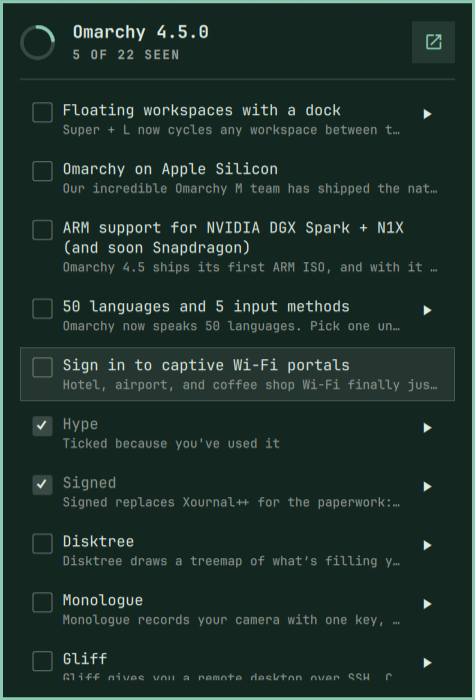

# newmarchy

An Omarchy bar widget that turns each Omarchy release into a checklist, so
after an update you can tell what's new and know you've actually seen it.



- **Bar icon** for the release you're running: a circle that fills as you
  check items off, from empty to a full disc once you've seen everything.
  Hover it for the count.
- **Click** to open the checklist. It follows the release notes: for 4.5
  that's the topics of the [omarchy.org post](https://omarchy.org/news/2026/11/omarchy-4-5/),
  in page order, with each of the new default apps on a line of its own. The long lists under them (More features, Security, Fixes)
  sit collapsed underneath, readable but not counted.
- **Click an item** to read its full text, and **tick its box** once you've
  seen it.
- **Try it**: the ▶ button on a row opens the feature when there is
  something to open (the language picker, workspace layouts, Elsewhen, the
  Quake console, the background picker, a test notification), and ticks the
  item. On "Jade Horse joins the default themes" it switches your theme to
  Jade Horse; the theme menu (Super + Ctrl + Shift + Space) switches back.
- **Ticks itself** when it can see you've used something new (see below).
- **Right-click** the icon, or press the notes button, to open the notes the
  checklist came from.

## Install

```bash
omarchy plugin add https://github.com/yamz8/newmarchy.git --enable
```

Needs nothing beyond a standard Omarchy 4 install. It uses `curl` and `bash`
to fetch the notes, `jq` to detect what you've tried, and `hyprctl`,
`uwsm-app` and the `omarchy-*` commands for the Try buttons.

## Keys

| Key | Action |
| --- | --- |
| ↑ ↓ / j k | Move (the first press shows the cursor) |
| Space | Check or uncheck |
| Enter | Read the item's full text |
| t | Try it |
| a | Mark all seen, or clear them all |
| Esc | Close |

IPC, for a keybinding or a script:

```bash
omarchy-shell yamz8.newmarchy toggle
omarchy-shell yamz8.newmarchy unseen    # prints how many are unseen
omarchy-shell yamz8.newmarchy refresh
```

## Where the notes come from

The [GitHub releases](https://github.com/omacom/omarchy/releases) of
`omacom/omarchy`, fetched over HTTPS when the shell starts and when the panel
opens (at most once every ten minutes). There is no background polling. Each
response is capped at 4 MiB and every title and description is bounded and
rendered as plain text.

A stable release such as v4.5.0 is a short summary on GitHub with a link to
its post on omarchy.org. When the release links to
`https://omarchy.org/news/<year>/<month>/<slug>/`, newmarchy reads that page
once and builds the checklist from it: each `<h2>` topic written as prose is
an item, and a topic that is only a list is a collapsed section. A topic
whose paragraphs each open on a bold name, as "Five new default apps" does
(**Hype** …, **Signed** …), becomes one item per name in the same place.

Without such a link, or if the page can't be read, it falls back to GitHub.
When a final release has less to check off than its last release candidate,
the candidate's notes are used. The notes button's tooltip says where the
list came from.

The installed version is read locally with `omarchy-version`, once an hour
and whenever the panel opens, so the icon follows an update without a shell
restart.

## What it can tell you've tried

`bin/newmarchy-detect` checks local state, read-only and offline, when the
shell starts, when the panel opens, and once an hour. For 4.5.0 it ticks:

| Item | Signal |
| --- | --- |
| 50 languages and 5 input methods | `omarchy-language` is not `en` |
| Floating workspaces with a dock | a workspace layout file says `floating` |
| Agent upgrades | the `special:qconsole` workspace (the Quake console) exists |
| Hype, Signed, Disktree, Monologue, Gliff | that app has a config or state directory |
| Elsewhen | Elsewhen has cities of your own in the bar |
| Video backgrounds and theme intros | the current background is a video file |
| Jade Horse joins the default themes | Jade Horse or Starship is the current theme |

The ▶ on an app's line shows only when that app is installed. Each item is
ticked by detection at most once. If you untick it, it stays
unticked. Items ticked this way say so under their title.

The try commands and signals are written by hand per release in
`Features.js`, keyed by item title, for both the omarchy.org post and the
rc3 notes; `tests/features.test.mjs` checks every one against copies of
both in `tests/fixtures/`.

## State

What you've checked off is kept in `~/.local/state/newmarchy/seen.json`,
keyed by release tag. Delete the file to start over.

## Remove

```bash
omarchy plugin remove yamz8.newmarchy
rm -rf ~/.local/state/newmarchy
```

## Development

```bash
omarchy plugin validate .
node --test tests/*.mjs
```

All parsing lives in `Newmarchy.js` and the per-release knowledge in
`Features.js`; the tests run both under `node:vm`.

## License

MIT
